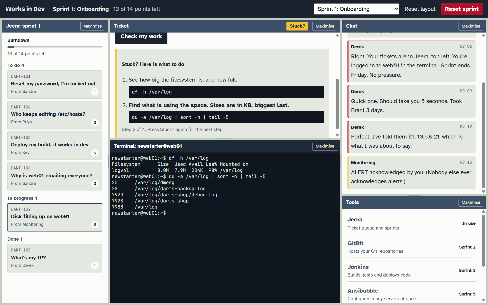

# Works in Dev

A browser game that teaches real DevOps skills. It's 2014, you're the new operations hire at Darts Unlimited, and the developers keep throwing builds over the fence.

Sister project of [learndevops.co.uk](https://dmccuk.github.io/learndevops/). The game design is in [docs/DESIGN.md](docs/DESIGN.md).

**[Play it in your browser](https://dmccuk.github.io/worksindev/)**. Nothing to install, no account.

## How to play

You work it like a real sysadmin's first week: the work comes to you, and nobody takes your word for it.

1. **Clock in.** Pick a username. It becomes your real login on the servers, with the password `Welcome1`. Starting the servers takes about 20 seconds.
2. **Read the queue.** Your Jeera tickets are top left. You don't choose what arrives, but you choose the order. Big tickets are worth more points.
3. **Open a ticket.** Read who sent it and what they actually need, which is not always what they asked for.
4. **Fix it in the terminal.** It's real Linux. Find the problem with real commands (`df`, `grep`, `ssh`, `crontab`, `git`), then fix it. Use `sudo` when you need root.
5. **Press Check my work.** A check reads the server to see whether it's really fixed. If it isn't, it tells you what it found. Some tickets want an answer typed in instead.
6. **Watch the chat.** Interruptions arrive mid-sprint ("URGENT: printer broken"). Dealing with them is part of the job.
7. **Close every ticket** to reach the sprint review, answer the retro, and get promoted to the next sprint.

**Stuck?** Press the yellow **Stuck?** button on any ticket. Each press shows one more step, with the command to try. Steps you've already done are marked as done.

**Tips**

- Drag the borders between panels to resize them, or press **Maximise** to give the terminal the whole screen.
- Fix the cause, not the symptom. Deleting a log someone needs, or removing a job instead of fixing its schedule, won't pass.
- Progress saves in your browser. **Reset sprint** (in red) starts the sprint again with fresh servers.

## Commands

- `npm run dev`: local site at <http://localhost:4321/worksindev/>
- `npm run build`: build into `dist/`
- `npm run check`: `astro check`

Astro needs Node.js 22.22 or later. CI uses Node 24 (`.nvmrc`).

## Contributing

Lived through an incident that would make a good ticket? [Submit a ticket from your career](../../issues/new?template=war-story.yml). Want to write code or a whole sprint? See [CONTRIBUTING.md](CONTRIBUTING.md).

## Licence

© 2026 Dennis McCarthy. Licensed under [Creative Commons Attribution-NonCommercial-ShareAlike 4.0](LICENSE) (CC BY-NC-SA 4.0). You may copy, fork and change it, as long as you:

- **credit** Dennis McCarthy and link back to this repository;
- **don't use it commercially**: no selling it, charging for access, or using it in paid training;
- **share your changes under the same licence**.

Third-party software keeps its own licence: see [NOTICE.md](NOTICE.md).
